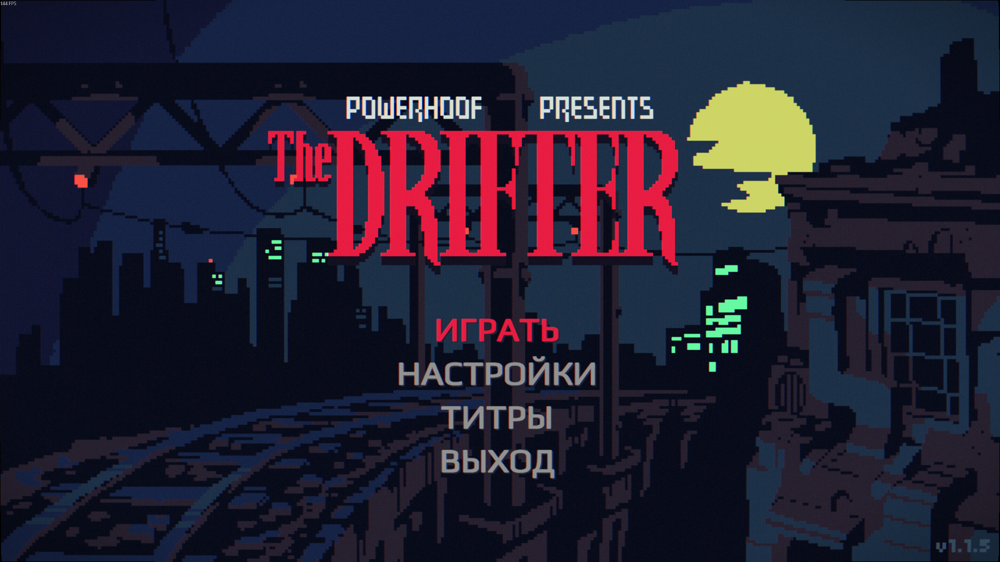
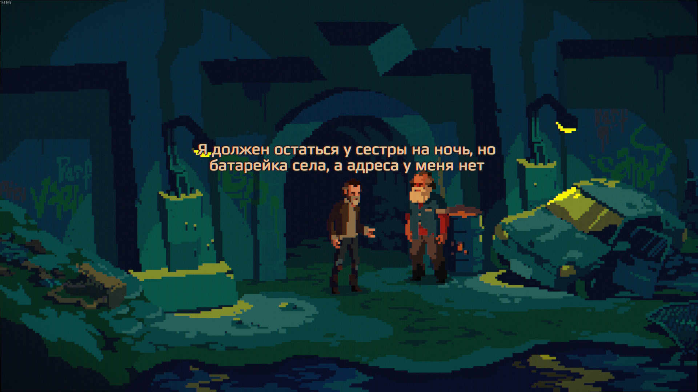
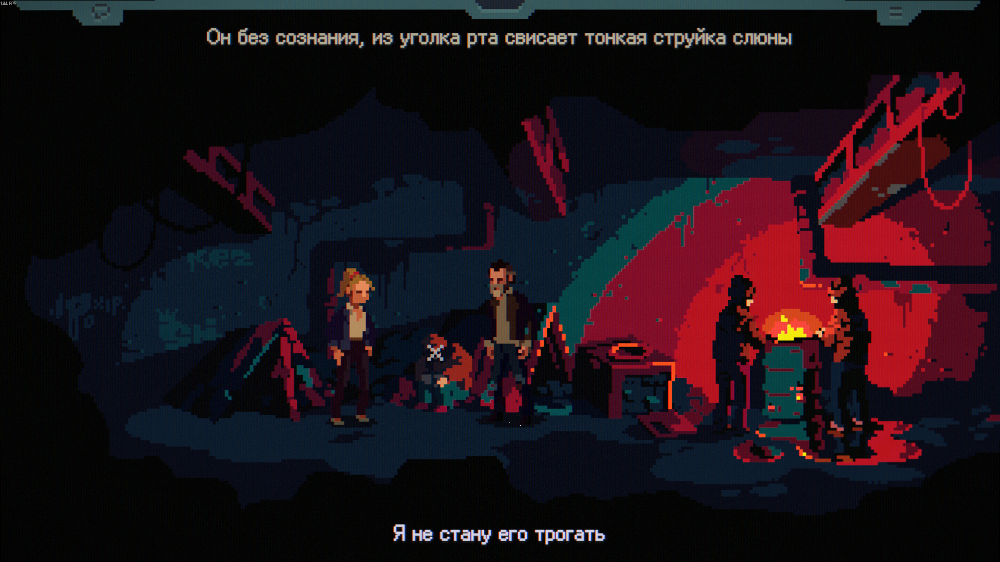

# The Drifter RU

A complete Russian localization of The Drifter: 9,803 translated lines in one
CSV file, with an installer that puts Cyrillic into the game's pixel fonts.

[Русская версия этого описания](README_ru.md).

The Drifter has no Russian and none of its fonts carry Cyrillic. This
repository holds the translation and the tool that installs it: the installer
copies `translation.csv` next to the game, writes Cyrillic glyphs into the
fonts the game draws its text with, and keeps a backup of everything it
touches.



[](LICENSE)
[](https://github.com/aa-blinov/the-drifter-ru/actions/workflows/ci.yml)
[](src/)

---

## Quick start

Download the [v1.0.0 install pack](https://github.com/aa-blinov/the-drifter-ru/releases/download/v1.0.0/the-drifter-ru-v1.0.0.zip),
extract it anywhere, close the game and run `install.bat`. It needs
[Python 3.9 or newer](https://www.python.org/downloads/) on the `PATH` and finds
the game in your Steam libraries by itself.

Then in the game: **Options → Language → Русский**. The language also switches
with **V** while playing.

From a source checkout instead of the pack:

```bash
git clone https://github.com/aa-blinov/the-drifter-ru.git
cd the-drifter-ru
python3 -m pip install -r requirements.txt
python3 scripts/fetch_fonts.py
python3 scripts/install.py --game "C:/Program Files (x86)/Steam/steamapps/common/The Drifter"
```

`--dry-run` shows what would be written and writes nothing. The original
`sharedassets1.assets` is saved in `_ru_backup` inside the game folder; to
undo, copy it back and delete `translation.csv`, or let Steam verify the game
files.

## What it does

- **Every line of the game.** 9,803 strings: dialogue, item descriptions,
  interface hints, conversation topics and room names. Every English line has
  a Russian one.
- **One voice.** The terms were translated first and frozen in a glossary of
  277 entries; every later pass was bound to it. One English line gets one
  Russian wording across the file.
- **The game's own format.** `translation.csv` is UTF-8 with a BOM and CRLF
  line ends, with the language named in the last column, as the importer of the
  game reads it.
- **Cyrillic in the game's fonts.** The installer builds Cyrillic for each of
  the twelve fonts that draw text. Pixel fonts take Ark Pixel glyphs laid on
  their own grid, and smooth ones take outlines from Play. The menu and the
  dialogue captions, which the game draws in a smooth font, are drawn in Ark
  Pixel as a whole, so Latin and Cyrillic come from one face.
- **Russian is as long as English.** Measured against the real fonts of the
  game, the median width ratio is 0.97 to 1.00, and the panels of the game
  overflow no more often than they do in English. The numbers are in
  [docs/layout.md](docs/layout.md).
- **A repeatable pipeline.** Corpus extraction, glossary, translation, an
  editorial pass, canonicalisation, checks and the build. Every model call is
  cached on disk, so an interrupted run resumes without paying twice.

## Screenshots

| Main menu | Dialogue |
| :---: | :---: |
|  |  |

| Object caption |
| :---: |
|  |

## Configuration

| Option | Default | What it does |
| --- | --- | --- |
| `--game` | found in Steam | The game folder, the one that holds `TheDrifter.exe`. |
| `--size` | `0.95` | Size of Cyrillic against Latin: 1.0 is level with it, 0.9 is visibly smaller. |
| `--bold` | `0` | How much heavier to make the Cyrillic, in font units. |
| `--no-pixel-ui` | off | Keep the smooth game font for the menu and the captions. |
| `--no-fonts` | off | Install only the text and leave the fonts alone. |

## Known issues

- **The HD dialogue font switch does nothing.** The language file forces the HD
  font on (row 100000, `Force HD Font`). Without it the game draws text with
  its own pixel fonts, and Cyrillic in the fonts with a 5 pixel capital is not
  legible. The switch in the options stays inert on purpose.
- **A game update can add lines.** The translation was built against one build
  of the English corpus; lines the update adds stay in English until the corpus
  is extracted and translated again.

## Contributing

Read [CONTRIBUTING.md](CONTRIBUTING.md) before proposing translation or code
changes. The project follows the [Code of Conduct](CODE_OF_CONDUCT.md); the
[release process](docs/release-process.md) explains versions and publishing.

## Development

```bash
python3 -m pip install -r requirements.txt   # fonttools, unitypy
python3 -m unittest discover -s tests         # check the shipped CSV
python3 src/drru/qa.py                        # checks, with findings
python3 src/drru/build.py                     # corpus into the CSV
python3 scripts/build_release.py 1.0.0        # the install pack, in dist/
```

The pipeline needs a model endpoint, and the full run is in
[AGENTS.md](AGENTS.md). The design is in
[docs/architecture.md](docs/architecture.md), the voice in
[docs/style-guide.md](docs/style-guide.md), the glossary in
[docs/glossary.md](docs/glossary.md).

## License

The translation and the code are under the MIT license, see [LICENSE](LICENSE).
The Drifter and its text belong to Powerhoof, and no game files are in this
repository. Ark Pixel and Play, which the Cyrillic is built from, are under the
SIL Open Font License 1.1; the installer copies both licenses into
`TheDrifter_Data` next to the patched fonts.
