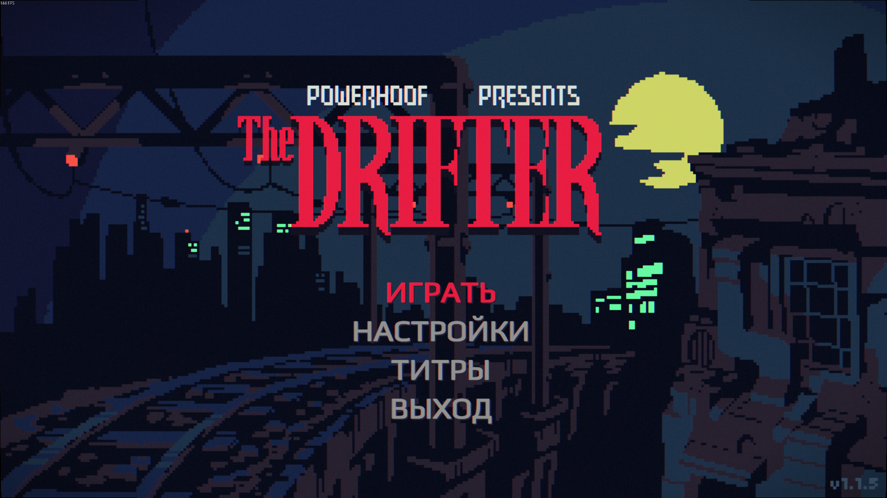
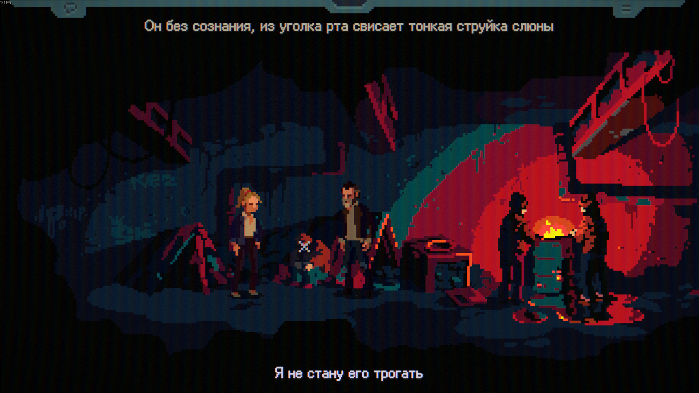

# The Drifter RU: русский перевод The Drifter

Полная русская локализация The Drifter: 9 803 переведённые строки в одном
CSV-файле и установщик, который вписывает кириллицу в пиксельные шрифты игры.

[English version of this README](README.md).

> [!TIP]
> Чтобы начать играть, перейдите к разделу [Установка](#установка).
> Чтобы помочь с переводом, прочитайте [инструкцию для участников](CONTRIBUTING.md).

## Игра на русском

| Главное меню | Подписи |
|:---:|:---:|
|  |  |

## Установка

В The Drifter нет русского языка, и ни один шрифт игры не содержит кириллицы.
Поэтому перевод ставится установщиком: он кладёт `translation.csv` рядом с игрой,
вписывает кириллицу в шрифты и сохраняет резервную копию всего, к чему
прикасается.

1. Закройте игру. Нужен [Python 3.9 или новее](https://www.python.org/downloads/)
   в `PATH`.
2. Скачайте [пакет установки v1.0.1](https://github.com/aa-blinov/the-drifter-ru/releases/download/v1.0.1/the-drifter-ru-v1.0.1.zip)
   со [страницы релизов](https://github.com/aa-blinov/the-drifter-ru/releases).
   Архивы `Source code` для установки не нужны.
3. Распакуйте архив в любую папку и запустите `install.bat`. Он поставит
   зависимости, скачает шрифты Ark Pixel и Play и найдёт игру в библиотеках
   Steam. Если игра лежит в другом месте:
   `install.bat --game "D:\Games\The Drifter"`.
4. В игре: **Options → Language → Русский**. Язык переключается и на лету
   клавишей `V`.

Проверить, ничего не записывая: `install.bat --dry-run`.

**Как убрать перевод.** Удалите `translation.csv` из папки игры и скопируйте
`_ru_backup\sharedassets1.assets` поверх `TheDrifter_Data\sharedassets1.assets`.
Либо в Steam: правая кнопка по игре, Свойства, Установленные файлы, Проверить
целостность файлов.

**После обновления игры.** Обновление Steam может вернуть оригинальные ассеты.
Запустите `install.bat` ещё раз.

Из исходников, без пакета:

```powershell
python scripts/fetch_fonts.py
python scripts/install.py --game "C:\Program Files (x86)\Steam\steamapps\common\The Drifter"
```

## Что внутри

- **9 803 строки.** Весь текст игры: диалоги, описания предметов, подсказки
  интерфейса, темы разговоров, названия комнат. Каждая английская строка имеет
  русскую.
- **Один голос.** Глоссарий из 277 терминов заморожен до перевода основного
  текста; каждый последующий этап привязан к нему. Одна английская строка
  получает один русский вариант во всём файле.
- **Формат игры.** `translation.csv` в том виде, в котором его читает импортёр
  игры: UTF-8 с BOM, CRLF, колонка `Русский`.
- **Кириллица в шрифтах игры.** Установщик собирает кириллицу под профиль каждого
  из двенадцати шрифтов, которые рисуют текст: в пиксельные она ложится на их
  сетку из Ark Pixel, в гладкие приходит из контуров Play. Меню и подписи
  реплик игра рисует гладким шрифтом; установщик заменяет его Ark Pixel
  целиком, и латиница с кириллицей идут одной гарнитурой.
- **Русский текст равен английскому по длине.** Измерено по настоящим шрифтам
  игры: медиана отношения ширины 0.97–1.00, панели игры переполняются не чаще,
  чем в оригинале. Числа и способ их получения в
  [docs/layout.md](docs/layout.md).
- **Пайплайн.** Извлечение корпуса, глоссарий, перевод, редакторский проход,
  канонизация, проверки, сборка. Каждый вызов модели кэшируется на диске, поэтому
  прерванный прогон можно продолжить, не потратив ничего дважды.

## Настройки установщика

| Параметр | По умолчанию | Что делает |
| --- | --- | --- |
| `--game` | ищется в Steam | Папка игры, где лежит `TheDrifter.exe`. |
| `--size` | `0.95` | Размер кириллицы против латиницы: 1.0 вровень, 0.9 заметно меньше. |
| `--bold` | `0` | Насколько утолщить кириллицу, в единицах шрифта. |
| `--no-pixel-ui` | выкл. | Оставить гладкий шрифт игры в меню и подписях реплик. |
| `--no-raster` | выкл. | Рисовать меню и подписи со сглаживанием: края становятся мягкими. |
| `--no-fonts` | выкл. | Поставить только текст, шрифты не трогать. |

## Известные проблемы

- **Цветная кайма у букв.** Красные и синие края и зернистость дают не шрифт, а
  CRT-фильтр самой игры: в оригинальной английской сборке они такие же.
  Нажмите в игре **Left Shift + F**, и фильтр выключится (появится окно «Camera
  CRT filter disabled»); игра запоминает выбор. Те же клавиши включают его
  обратно.
- **Переключатель «HD-шрифт диалогов» ничего не меняет.** Языковой файл
  принудительно включает HD-шрифт (строка 100000, `Force HD Font`). Без этого
  игра рисует текст своими пиксельными шрифтами, а в шрифтах с заглавной
  в 5 пикселей кириллица нечитаема. Переключатель в настройках остаётся
  неактивным намеренно.
- **Обновление игры может добавить строки.** Перевод собран против одной сборки
  английского корпуса; новые строки остаются на английском, пока корпус не
  извлечён и не переведён заново.

## Участие в проекте

Перед предложением правок прочитайте [CONTRIBUTING.md](CONTRIBUTING.md). Проект
следует [кодексу поведения](CODE_OF_CONDUCT.md); версии и публикацию описывает
[процесс релиза](docs/release-process.md).

## Разработка

```bash
python3 -m pip install -r requirements.txt   # fonttools, unitypy
python3 -m unittest discover -s tests         # проверка отгружаемого CSV
python3 src/drru/qa.py                        # проверки, с находками
python3 src/drru/build.py                     # корпус становится CSV
python3 scripts/build_release.py 1.0.0        # пакет установки в dist/
```

Пайплайну нужен эндпоинт модели; полный прогон описан в [AGENTS.md](AGENTS.md).
Устройство: [docs/architecture.md](docs/architecture.md). Голос перевода:
[docs/style-guide.md](docs/style-guide.md). Глоссарий:
[docs/glossary.md](docs/glossary.md).

## Лицензия

Перевод и код под лицензией MIT, см. [LICENSE](LICENSE). The Drifter и её текст
принадлежат Powerhoof; в репозитории нет файлов игры. Ark Pixel и Play, из
которых собирается кириллица, распространяются по SIL Open Font License 1.1;
установщик копирует обе лицензии в `TheDrifter_Data` рядом с пропатченными
шрифтами.
